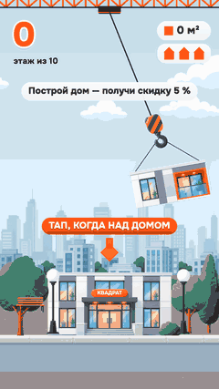
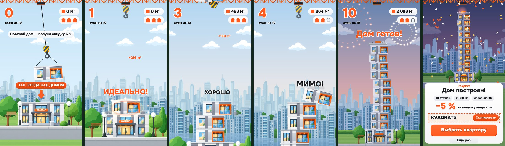
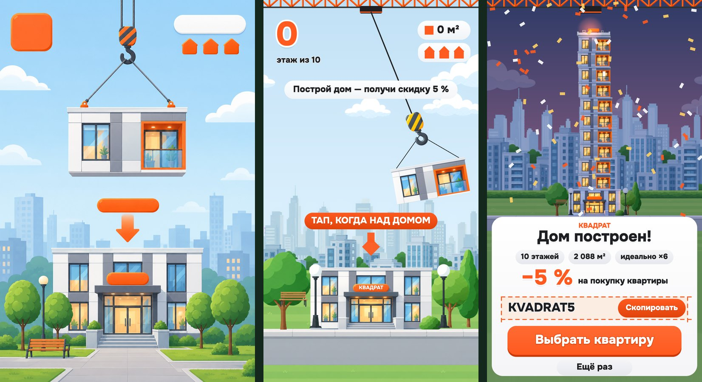

# Построй дом — playable-реклама застройщика «Квадрат»

**▶ Играть:** открой `docs/index.html` (или любой локальный сервер: `python3 -m http.server` и `/live/index.html?ad=1`).
A/B-варианты: `docs/floors7.html`, `docs/surprise.html`. Тап или пробел — сбросить этаж, звук включается после первого касания.

<p align="center"><br><sub>авто-прогон, 25 с до эндкарда</sub></p>

Портретная 2D playable-реклама: кран качает на тросе этаж жилого дома, ты тапаешь, когда он над домом, и строишь башню из десяти этажей и крыши. Достроил — получаешь промокод на скидку 5 % на квартиру. Оранжево-белая фирменная гамма застройщика, один палец, без обучающих рук: первый экран объясняет всё тремя вещами — строкой оффера, плашкой «ТАП, КОГДА НАД ДОМОМ» и стрелкой к дому.

Весь пайплайн — от референса до билдов — пройден собственными скиллами для Claude Code.



От концепт-кадра до игры (слева сгенерированный концепт, дальше кадры игры):



## Как играть

1. Блок качается на крюке крана. Тап — он падает отвесно (0.34 с).
2. Попал в центр — **«ИДЕАЛЬНО!»**: этаж встаёт ровно, серия ×2, ×3… даёт бонус и успокаивает башню. Сдвиг до 22 % ширины — «ОТЛИЧНО», до 29 % — «ХОРОШО»: этаж встаёт со сдвигом. Дальше — «МИМО!»: блок валится через край, минус одно сердце из трёх.
3. С четвёртого этажа башня сама начинает раскачиваться, и тем сильнее, чем кривее стоят этажи; идеальная посадка гасит качание вдвое.
4. Сердца кончились — «Дом не достроен», кнопка «Заново» (или тап в любое место) начинает дом с первого этажа. Каждая новая попытка чуть снисходительнее к точности, скорость блока при этом не меняется.
5. Крыша встала — салют, окна загораются волной, звучит победная музыка и появляется эндкард: «Дом построен!», итоги (этажи, метры, идеальные посадки), промокод с кнопкой «Скопировать» и «Выбрать квартиру».

Блок качается с **одной постоянной скоростью** от первого этажа до крыши (период 2.0 с, размах 300 px): сложность растёт от башни, а не от блока. Таймеров нет: игра ждёт тапа сколько угодно, эндкард показывается только после достроенного дома. Для сетей, где нужен эндкард «всегда», правило возвращается двумя числами в варианте (`"K": { "END_NO_INPUT": 12, "END_IDLE": 10 }`). Весь экран эндкарда — кнопка «Выбрать квартиру» (кнопки «Скопировать» и «Ещё раз» проверяются раньше), и она заодно копирует промокод.

## Что внутри за 25 секунд (авто-прогон)

| время | бит | что видит зритель |
|---|---|---|
| 0–2.5 с | хук | утро над городом, на кране качается этаж, строка «Построй дом — получи скидку 5 %», плашка «ТАП, КОГДА НАД ДОМОМ» над лобби с вывеской «КВАДРАТ» |
| 2.8 с | первая посадка | «ИДЕАЛЬНО!», пыль, кольцо и искры, «+180 м²» летит в счётчик |
| 4.5 с | серия | второй идеальный подряд: «×2», счётчик растёт |
| 6–8 с | нарастание | «ХОРОШО» (этаж встаёт со сдвигом), башня начинает качаться с 4-го этажа |
| 9.2 с | промах | «МИМО!», блок кувыркается через край, трескается сердце |
| 11.5 с | «Полпути!» | небо уходит в золотой час |
| 19.8 с | «Осталась крыша!» | последний блок — крыша с вывеской |
| 21.5–25.4 с | финал | салют, дом оседает почти ровно, вечер, окна загораются волной снизу вверх, победная тема |
| 25.4 с | эндкард | «Дом построен!», −5 %, промокод `KVADRAT5`, «Выбрать квартиру», «Ещё раз» |

## Очки и механика в числах

- Этаж 380 × 180 px (пропорция 2.1 : 1, как на концепт-кадре), лобби 620 × 312, крыша 396 × 105. Вид 1080 px в ширину, высота по телефону (16:9 … 19.5:9).
- За этаж 180 м², за идеальную посадку ещё 36 м² × серия. Итог авто-прогона — 2 088 м².
- Пороги (в долях ширины этажа): идеально ≤ 8 %, отлично ≤ 22 %, хорошо ≤ 29 %, дальше промах. Для первого этажа на лобби предел считается от края лобби (лобби шире этажа).
- Скрытая помощь, не трогающая скорость блока: порог промаха шире на 10 % после двух промахов подряд и на 8 % за каждую новую попытку (до двух).
- Раскачка башни: с 4-го этажа амплитуда 4 px на этаж плюс 4 % от суммарной кривизны, не больше 60 px, период 3.4 с.

## A/B-варианты

| вариант | что меняется | гипотеза |
|---|---|---|
| `floors10` (основной) | 10 этажей и крыша | достаточно вызова, чтобы промокод ощущался заработанным |
| `floors7` | 7 этажей и крыша | короче путь до эндкарда — больше игроков видят промокод и жмут CTA |
| `surprise` | на старте «Построй дом мечты» (без скидки), в финале «А это — вам!» | сюрприз конвертит лучше заранее известной скидки |

Сравнивать стоит долю досмотра до эндкарда, копирование промокода, CTR кнопки «Выбрать квартиру» и долю «Ещё раз».

## Темп (прогон 1 000 «игроков» без браузера)

`node tools/bots.mjs 1000 --variant floors10` — боты тапают с человеческой погрешностью по времени: 60 % «предугадывающих» (σ 45–110 мс), 30 % «реагирующих» (видят блок с задержкой 190–280 мс и опережают её), 10 % «спамеров» (тапают сразу); у каждого своё «терпение» (0–2 пропущенных прохода блока), 10 % бросают после первого проигрыша, 5 % после второго.

| метрика | `floors10` | `floors7` |
|---|---|---|
| доходят до эндкарда | 88 % (12 % бросили раньше) | 89 % |
| от старта до эндкарда, медиана / p95 | 35 с / 87 с | 26 с / 58 с |
| дом с первой попытки | 77 % | 85 % |
| дом за ≤ 3 попытки | 98 % | 99 % |
| хотя бы один промах за игру | 69 % | 61 % |
| «спамер» (тап без прицеливания) достраивает дом | 0 % | 0 % |

Побочные приёмы проверок: `tools/smoke_test.mjs` играет собранную игру на телефонном экране (настоящий тач, проигрыш → «Заново», прохождение до эндкарда, копирование, CTA), `tools/network_smoke.mjs` — вызовы API каждой сети (MRAID, DAPI, Mintegral `gameReady/gameEnd/install`, Google ExitApi, Meta `FbPlayableAd`), `tools/audio_probe.mjs` — что музыка играет, в том числе на эндкарде, и не клиппует.

## Картинка

Плоский вектор в духе современной российской рекламы жилья: белые и серые панельные фасады, оранжевые лоджии, мягкие тени. 19 спрайтов сгенерированы с первой попытки (этаж, лобби, крыша, крюк, стрела крана, два слоя города, двор, облака и вечерние версии этажа и лобби: на финале они плавно проявляются поверх дневных, и окна загораются волной). Этаж на крюке и все этажи башни — один и тот же спрайт; пустое место вокруг вырезано по ключевому цвету, швы стыкуются без зазоров. Небо — градиент в коде (день → золотой час → вечер), под городом река с отражением, параллакс двух слоёв города, деревья качает ветер. Текстуры 318 КБ из 6.8 МБ исходников (WebP).

## Звук

Ни одного звукового файла: всё на WebAudio. Игровой цикл — тихий пэд на четырёх аккордах (C–Am–F–G) с лёгким арпеджио и шейкером, скрип крана, громче на краях качания; щелчок сброса, глухой удар приземления (выше 250 Гц, чтобы слышно на телефонных динамиках), арпеджио идеальной посадки выше с каждым этажом серии. На финале игровая музыка гаснет, звучит риз-эффект, а когда загораются окна — победная тема: бочка, бас, хлопки, звонкие аккорды и колокольчики (C–G–Am–F, 112 уд/мин), она продолжается под эндкардом тише. Звук запускается после первого касания; он выключается, когда реклама уходит из видимой области (MRAID/DAPI/Mintegral) или вкладка скрыта.

## Размеры (все сети)

| сеть | файл | размер | лимит |
|---|---|---|---|
| AppLovin / Unity Ads / ironSource / Mintegral | `*.html` | 0.56 МБ | 5 МБ |
| Google Ads | `google.zip` | 0.38 МБ | 5 МБ |
| Meta | `meta.html` | 0.56 МБ | 2 МБ |

Подробности и экономия по текстурам — `docs/build-report.md`.

## Как собрать и запустить

```bash
python3 -m http.server 8967            # затем http://localhost:8967/live/index.html?ad=1  (без ?ad=1 — авто-прогон)
python3 tools/build_playable.py --variant all     # dist/<вариант>/<сеть>.html, report.md
node tools/bots.mjs 1000 --variant floors7        # воронка «игроков»; --k KEY=VAL переопределяет SIM.K
node tools/network_smoke.mjs dist/floors10/ironsource.html ironsource
```

Проверочные скрипты используют Playwright (`PLAYWRIGHT=<путь к модулю>`). Ссылка кнопки «Выбрать квартиру» в `tools/build.json` — заглушка: подставь настоящую ссылку на каталог квартир перед размещением.

## Структура

- `live/sim.js` — детерминированная симуляция (маятник, посадка, оценка, раскачка башни, сердца, финал), все числа в `SIM.K`; `live/scene.js` — отрисовка и HUD; `live/audio.js` — звук; `live/skin.js` — палитра и тексты стилей.
- `live/assets/` — спрайты; `live/fonts/` + `licenses/` — шрифт Onest (OFL).
- `variants/` — A/B-варианты; `tools/` — сборка и проверки; `docs/` — превью-страницы и медиа.
